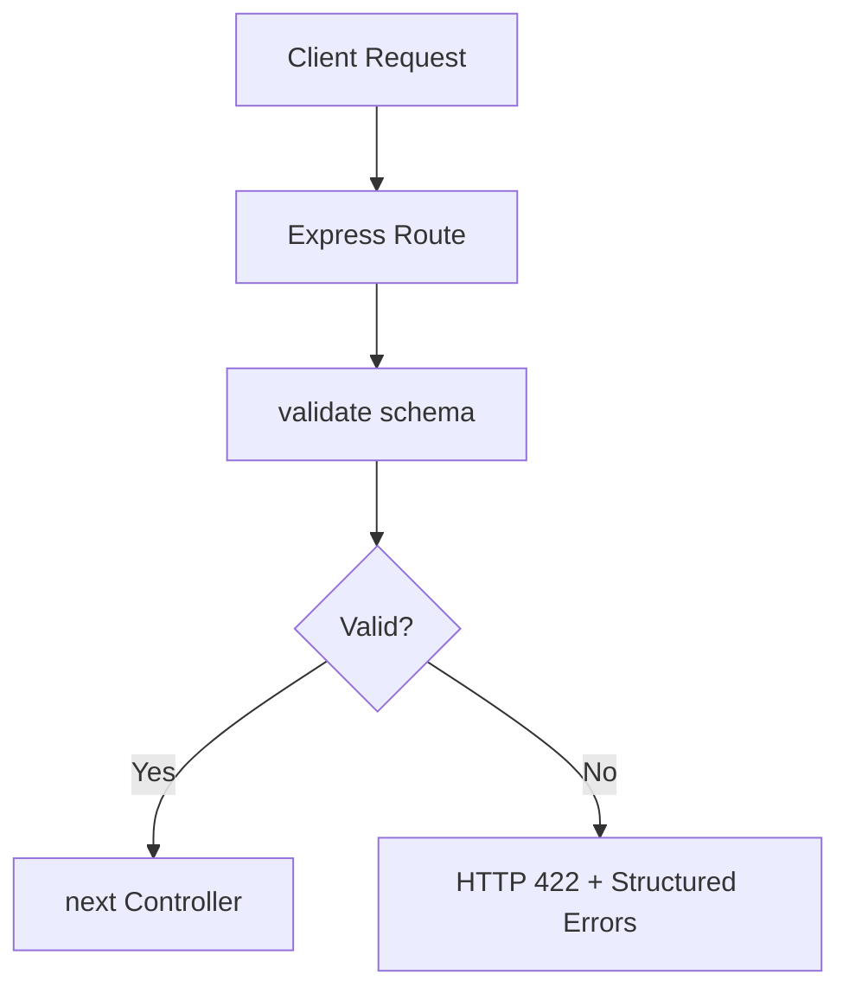

# EventFlow API

> Campus Event Management and Registration REST API built with Express.js, featuring schema validation powered by the published NPM package [`api-contract-guard`](https://www.npmjs.com/package/api-contract-guard).

---

## 📖 Table of Contents

- [Overview](#overview)
- [Key Features](#key-features)
- [Tech Stack](#tech-stack)
- [Project Structure](#project-structure)
- [Installation & Getting Started](#installation--getting-started)
- [Integration of `api-contract-guard`](#integration-of-api-contract-guard)
- [API Endpoints Reference](#api-endpoints-reference)
- [Usage Examples with cURL](#usage-examples-with-curl)
  - [Events](#events)
  - [Registrations](#registrations)
- [Error Handling Standards](#error-handling-standards)
- [Automated Testing](#automated-testing)
- [License](#license)

---

## 🌟 Overview

**EventFlow API** is a lightweight, robust REST API designed for campus event planning and student registration. The application serves as a real-world demonstration of **[`api-contract-guard`](https://www.npmjs.com/package/api-contract-guard)**—a published Express middleware package for validating request payloads against developer-defined schemas before reaching route controllers.

---

## ✨ Key Features

1. **Complete Event Management (CRUD)**:
   - Create, retrieve, update, and delete campus events.
   - Validates event existence, integer IDs, and required event properties.

2. **Event Registration & Capacity Management**:
   - Register students with their name, email, and event ID.
   - Enforces capacity limits to prevent overbooking.
   - Prevents duplicate registrations for the same student on the same event (case-insensitive email matching).
   - Filter registrations by event ID (`?eventId=`).
   - Cancel registrations cleanly.

3. **Schema Validation via `api-contract-guard`**:
   - Reusable validation contracts for creating events, updating events, and registering attendees.
   - Multi-rule checks: required fields, data types (`string`, `number`, `email`), length constraints (`minLength`), and numeric bounds (`min`).
   - Returns structured `422 Unprocessable Entity` responses reporting all validation errors at once.

4. **Centralized Error Handling**:
   - Uniform JSON error formats for all responses.
   - Graceful handling of malformed JSON payloads (`400 Bad Request`).
   - Catch-all 404 handler for undefined API routes.
   - Internal error protection: sensitive server details and stack traces are never exposed to clients.

5. **Automated Testing Suite**:
   - 32 automated tests covering positive flows, edge cases, validation rejections, and error states using Node.js's built-in test runner.

---

## 🛠 Tech Stack

- **Runtime**: Node.js (v18+)
- **Framework**: Express.js 5
- **Validation**: [`api-contract-guard`](https://www.npmjs.com/package/api-contract-guard)
- **Data Persistence**: JSON-based storage (`src/data/`)
- **Testing**: Node.js Native Test Runner (`node:test`, `node:assert`)

---

## 📁 Project Structure

```text
EventFlow-API/
├── package.json               # Project manifest, dependencies, and scripts
├── README.md                  # Comprehensive API documentation
├── src/
│   ├── index.js               # Express application entry point & route mounting
│   ├── data/
│   │   ├── events.json        # Persistent event records
│   │   └── registrations.json # Persistent registration records
│   ├── middleware/
│   │   └── errorHandler.js    # Centralized error-handling middleware
│   ├── routes/
│   │   ├── events.js          # Event CRUD routes & validation middleware
│   │   └── registrations.js   # Event registration routes & business logic
│   └── schemas/
│       └── index.js           # Reusable schemas for api-contract-guard
└── tests/
    └── api.test.js            # 32 automated unit and integration tests
```

---

## 🚀 Installation & Getting Started

### Prerequisites

- Node.js (v18.0.0 or higher recommended)
- npm (v9.0.0 or higher)

### 1. Clone the Repository

```bash
git clone https://github.com/sachityadav-2007/EventFlow-API.git
cd EventFlow-API
```

### 2. Install Dependencies

```bash
npm install
```

### 3. Run the Server

- **Start in Production Mode**:
  ```bash
  npm start
  ```
- **Start in Development Mode** (auto-reload via nodemon):
  ```bash
  npm run dev
  ```

The server starts by default on `http://localhost:3000`.

---

## 🛡 Integration of `api-contract-guard`

The project imports and integrates the published NPM package:

```bash
npm install api-contract-guard
```

### How It Works

`api-contract-guard` is executed as standard Express middleware on target routes. When a request arrives:
1. The middleware validates `req.body` against the defined schema.
2. If validation passes, `next()` is called and the controller executes.
3. If validation fails, `next()` is **not** called. The middleware directly returns an `HTTP 422 Unprocessable Entity` with an `errors` object mapping each failing field to its error message.



### Schema Definitions (`src/schemas/index.js`)

```javascript
const { validate } = require("api-contract-guard");

const createEventSchema = {
  title: {
    type: "string",
    required: true,
    minLength: 3,
  },
  date: {
    type: "string",
    required: true,
  },
  location: {
    type: "string",
    required: true,
    minLength: 2,
  },
  maxParticipants: {
    type: "number",
    required: true,
    min: 1,
  },
};

const registrationSchema = {
  name: {
    type: "string",
    required: true,
    minLength: 2,
  },
  email: {
    type: "email",
    required: true,
  },
  eventId: {
    type: "number",
    required: true,
    min: 1,
  },
};
```

### Route Integration (`src/routes/events.js`)

```javascript
const { validate } = require("api-contract-guard");
const { createEventSchema, updateEventSchema } = require("../schemas");

// Middleware intercepts invalid requests before the controller runs
router.post("/", validate(createEventSchema), (req, res) => {
  // Controller logic only runs for valid requests
});

router.put("/:id", validate(updateEventSchema), (req, res) => {
  // Controller logic only runs for valid requests
});
```

---

## 📡 API Endpoints Reference

### Base URL: `http://localhost:3000`

| Method | Endpoint | Description | Validation Middleware |
|---|---|---|---|
| `GET` | `/` | API status and welcome message | None |
| `GET` | `/api/events` | List all events | None |
| `GET` | `/api/events/:id` | Get event details by ID | Route parameter check |
| `POST` | `/api/events` | Create a new event | `validate(createEventSchema)` |
| `PUT` | `/api/events/:id` | Update an existing event | `validate(updateEventSchema)` |
| `DELETE` | `/api/events/:id` | Delete an event by ID | Route parameter check |
| `GET` | `/api/registrations` | List all registrations (supports `?eventId=`) | Query filter |
| `GET` | `/api/registrations/:id` | Get registration details by ID | Route parameter check |
| `POST` | `/api/registrations` | Register a student for an event | `validate(registrationSchema)` |
| `DELETE` | `/api/registrations/:id` | Cancel a registration | Route parameter check |

---

## 💻 Usage Examples with cURL

### Events

#### 1. List All Events
```bash
curl -X GET http://localhost:3000/api/events
```
**Response (200 OK):**
```json
{
  "success": true,
  "events": [
    {
      "id": 1,
      "title": "Campus Hackathon 2026",
      "date": "2026-12-20",
      "location": "ADYPU Pune",
      "maxParticipants": 100
    }
  ]
}
```

#### 2. Create Event (Valid Request)
```bash
curl -X POST http://localhost:3000/api/events \
  -H "Content-Type: application/json" \
  -d '{
    "title": "Web3 & Cloud Summit",
    "date": "2026-12-15",
    "location": "Auditorium Hall B",
    "maxParticipants": 150
  }'
```
**Response (201 Created):**
```json
{
  "success": true,
  "message": "Event created successfully",
  "event": {
    "id": 1794886332719,
    "title": "Web3 & Cloud Summit",
    "date": "2026-12-15",
    "location": "Auditorium Hall B",
    "maxParticipants": 150
  }
}
```

#### 3. Create Event (Invalid Request - `api-contract-guard` Rejection)
```bash
curl -X POST http://localhost:3000/api/events \
  -H "Content-Type: application/json" \
  -d '{
    "title": "AI",
    "date": "2026-12-15",
    "location": "A",
    "maxParticipants": 0
  }'
```
**Response (422 Unprocessable Entity):**
```json
{
  "success": false,
  "message": "Validation failed",
  "errors": {
    "title": "Minimum 3 characters required",
    "location": "Minimum 2 characters required",
    "maxParticipants": "Value must be at least 1"
  }
}
```

#### 4. Update Event
```bash
curl -X PUT http://localhost:3000/api/events/1 \
  -H "Content-Type: application/json" \
  -d '{
    "title": "Campus Hackathon 2026 - Extended",
    "date": "2026-12-22",
    "location": "Main Campus Arena",
    "maxParticipants": 120
  }'
```
**Response (200 OK):**
```json
{
  "success": true,
  "message": "Event updated successfully",
  "event": {
    "id": 1,
    "title": "Campus Hackathon 2026 - Extended",
    "date": "2026-12-22",
    "location": "Main Campus Arena",
    "maxParticipants": 120
  }
}
```

#### 5. Delete Event
```bash
curl -X DELETE http://localhost:3000/api/events/1
```
**Response (200 OK):**
```json
{
  "success": true,
  "message": "Event deleted successfully"
}
```

---

### Registrations

#### 1. Register for an Event (Valid Request)
```bash
curl -X POST http://localhost:3000/api/registrations \
  -H "Content-Type: application/json" \
  -d '{
    "name": "Sachit Kumar",
    "email": "sachit@example.com",
    "eventId": 1
  }'
```
**Response (201 Created):**
```json
{
  "success": true,
  "message": "Registration successful",
  "registration": {
    "id": 1794886740552,
    "name": "Sachit Kumar",
    "email": "sachit@example.com",
    "eventId": 1,
    "registeredAt": "2026-11-17T03:39:00.552Z"
  }
}
```

#### 2. Register with Invalid Email (`api-contract-guard` Rejection)
```bash
curl -X POST http://localhost:3000/api/registrations \
  -H "Content-Type: application/json" \
  -d '{
    "name": "Sachit Kumar",
    "email": "not-an-email",
    "eventId": 1
  }'
```
**Response (422 Unprocessable Entity):**
```json
{
  "success": false,
  "message": "Validation failed",
  "errors": {
    "email": "Invalid email format"
  }
}
```

#### 3. Prevent Duplicate Registration
```bash
curl -X POST http://localhost:3000/api/registrations \
  -H "Content-Type: application/json" \
  -d '{
    "name": "Sachit Kumar",
    "email": "sachit@example.com",
    "eventId": 1
  }'
```
**Response (409 Conflict):**
```json
{
  "success": false,
  "message": "Student is already registered for this event"
}
```

#### 4. Event Capacity Exceeded
When registrations reach `maxParticipants`:
**Response (400 Bad Request):**
```json
{
  "success": false,
  "message": "Event capacity reached. No more registrations allowed."
}
```

#### 5. List Registrations by Event
```bash
curl -X GET http://localhost:3000/api/registrations?eventId=1
```
**Response (200 OK):**
```json
{
  "success": true,
  "registrations": [
    {
      "id": 1794886740552,
      "name": "Sachit Kumar",
      "email": "sachit@example.com",
      "eventId": 1,
      "registeredAt": "2026-11-17T03:39:00.552Z"
    }
  ]
}
```

#### 6. Cancel Registration
```bash
curl -X DELETE http://localhost:3000/api/registrations/1794886740552
```
**Response (200 OK):**
```json
{
  "success": true,
  "message": "Registration cancelled successfully"
}
```

---

## 🛑 Error Handling Standards

All error responses adhere to a consistent JSON structure:

```json
{
  "success": false,
  "message": "Human-readable description"
}
```

### HTTP Status Code Conventions

- **`200 OK`**: Request succeeded.
- **`201 Created`**: Resource created successfully.
- **`400 Bad Request`**: Malformed JSON syntax, invalid ID parameter format, or business logic violations (e.g., event capacity reached).
- **`404 Not Found`**: Requested resource or endpoint does not exist.
- **`409 Conflict`**: Duplicate registration for the same event and email.
- **`422 Unprocessable Entity`**: Request body failed schema validation via `api-contract-guard`.
- **`500 Internal Server Error`**: Unexpected server errors (sanitized; internal stack traces never sent to clients).

---

## 🧪 Automated Testing

The project includes 32 automated tests executing across all endpoints, verifying both successful flows and failure branches.

### Run Tests

```bash
npm test
```

### Test Suite Output

```text
▶ Root Endpoint
  ✔ GET / returns welcome message
✔ Root Endpoint
▶ Event CRUD & api-contract-guard Validation
  ✔ GET /api/events returns all events
  ✔ GET /api/events/1 returns existing event
  ✔ GET /api/events/:id returns 400 for invalid ID
  ✔ GET /api/events/:id returns 404 for nonexistent event
  ✔ POST /api/events fails with 422 when required fields are missing (api-contract-guard)
  ✔ POST /api/events fails with 422 for incorrect field types (api-contract-guard)
  ✔ POST /api/events fails with 422 for boundary rule violations (api-contract-guard)
  ✔ POST /api/events creates an event successfully
  ✔ PUT /api/events/:id updates event successfully
  ✔ PUT /api/events/:id returns 422 when update body fails validation
  ✔ PUT /api/events/:id returns 404 for nonexistent event
  ✔ DELETE /api/events/:id deletes the created event
  ✔ DELETE /api/events/:id returns 404 for nonexistent event
✔ Event CRUD & api-contract-guard Validation
▶ Registration API & Capacity Management
  ✔ Setup: Create event with capacity 1
  ✔ POST /api/registrations fails with 422 for invalid email (api-contract-guard)
  ✔ POST /api/registrations fails with 422 for non-numeric eventId (api-contract-guard)
  ✔ POST /api/registrations fails with 404 for nonexistent event
  ✔ POST /api/registrations succeeds for valid registration
  ✔ POST /api/registrations fails with 409 for duplicate registration
  ✔ POST /api/registrations fails with 400 when event capacity is reached
  ✔ GET /api/registrations returns all registrations
  ✔ GET /api/registrations?eventId=:id filters registrations
  ✔ GET /api/registrations/:id returns registration by ID
  ✔ DELETE /api/registrations/:id cancels registration
  ✔ Cleanup: Delete temporary event
✔ Registration API & Capacity Management
▶ Error Handling & Bad Request Scenarios
  ✔ GET /api/nonexistent-route returns 404 JSON response
  ✔ POST /api/events with malformed JSON returns 400
✔ Error Handling & Bad Request Scenarios

ℹ tests 32
ℹ pass 32
ℹ fail 0
```

---

## 📄 License

ISC License.
